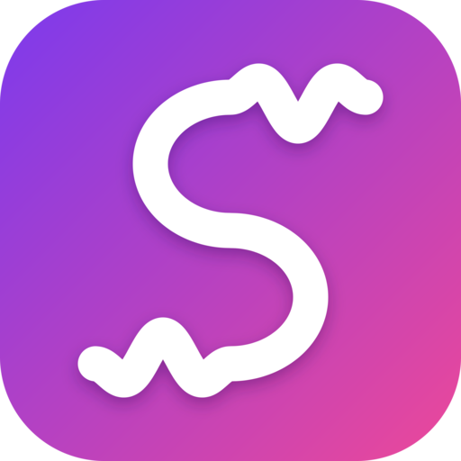

<p align="center">
  
</p>

<h1 align="center">Songies</h1>

<p align="center">
  A personal music player for Android, Windows and Linux that brings your own
  music files and YouTube Music together in one library.<br>
  <b>For educational purposes only.</b> See <a href="#license">License</a>.
</p>

---

## Features

**One library for everything**
- Your own MP3 folders, played in place (never copied), alongside songs from YouTube Music.
- Playlists you can reorder, swipe to edit and give your own cover picture.
- Import YouTube and YouTube Music playlists by link; Songies keeps them up to date.
- Search your library and YouTube Music together: songs, albums, artists and playlists.

**Listening**
- A Spotify-style queue: Add to queue plays songs next, in the order you add them.
- Shuffle, repeat, start a radio from any song, and media keys, notification and lock-screen controls.
- Now Playing with big artwork, a blurred cover background and swipeable Now playing / Lyrics / Queue pages on phones.
- Synced lyrics (from LRCLIB and YouTube Music) that follow the song; tap a line to jump there.
- Download YouTube songs and playlists for offline listening, with an optional Wi-Fi only switch.
- Listening stats: your top songs and artists and how much you listened, over the last 7 days up to 12 months.

**Make it yours**
- Themes: built-in ones, your own colours and fonts, or colours that follow the album cover.
- Optional YouTube sign-in for your own recommendations and history (kept in your system's secure storage, never synced).
- Discord status on Windows and Linux: show what you're listening to on your profile (off by default).

**Across your devices**
- Sync your library, playlists, themes, lyrics and stats between your devices on the same network: no account, no cloud.
- In-app updates: Songies finds a new release, checks its checksum and installs it over the top, keeping your library.

## Download

Get the latest version from the [Releases page](https://github.com/DenisMartonak/Songie/releases/latest):

| Platform | File | Notes |
| --- | --- | --- |
| Android 8+ | `songies-X.Y.Z.apk` | Allow installing from your browser or file manager when asked. |
| Windows 10/11 (64-bit) | `songies-X.Y.Z-windows-setup.exe` | SmartScreen may warn about an unknown publisher: More info, then Run anyway. |
| Linux (x86_64) | `songies-X.Y.Z-x86_64.AppImage` | `chmod +x` it and keep it in a folder you can write to, so updates can replace it. |

Each release also has a `SHA256SUMS` file to check your download against.

## Syncing devices

Open **Settings → Sync devices** on both devices (or the Sync devices button in the desktop sidebar). One shows a 6-digit code, the other types it in; after that, syncing is one tap. Both devices need Sync devices open at the time and must be on the same network. Your music files are copied across too; settings, sign-in and download choices stay on each device.

- **Linux:** allow port `47823/tcp` and the `mdns` service in your firewall and have Avahi installed so devices can find each other (without Avahi, use Connect by address).
- **Windows:** you may be asked to allow Songies on private networks.
- **Android:** syncing works while the app is open on that page.

## Discord status

On Windows and Linux, turn on **Settings → Discord → Show what I'm listening to**. With the Discord desktop app open, your profile shows *Listening to Songies* with the song, the artist and a progress bar; YouTube songs also show their cover and a *Listen on YouTube Music* button. Pausing clears it. Discord doesn't let apps do this from a phone. Setup details are in [`docs/discord.md`](docs/discord.md).

## Building from source

You need [Flutter](https://flutter.dev) 3.47 (Dart 3.13) and the usual platform tools (Android SDK, Visual Studio with C++ on Windows, or the GTK and libmpv development packages on Linux).

```sh
flutter pub get
flutter analyze
flutter test
flutter run -d linux        # or: -d windows, -d <android device>
```

- Releases are built and published by GitHub Actions when a version tag is pushed; see [`docs/releasing.md`](docs/releasing.md).
- The app icon is drawn by `tool/generate_icons.py` from `assets/icon/songies_icon.svg`.
- [`docs/manual-test-checklist.md`](docs/manual-test-checklist.md) lists the checks that need a real device.

## Disclaimer

Songies is an unofficial, independent project made for learning. It is not affiliated with, endorsed by or sponsored by YouTube, Google, LRCLIB or Discord, and all trademarks belong to their owners. Streaming or downloading content may be restricted by those services' terms and by copyright law where you live; you are responsible for how you use the app. Songies uses [yt-dlp](https://github.com/yt-dlp/yt-dlp) and many open-source Flutter packages, each under its own license.

## License

Songies is released under the [Songies Educational Use License](LICENSE): you may study, run, modify and share it for **educational and personal, non-commercial purposes**, keeping the license with every copy. Commercial use needs written permission. It comes with no warranty.
