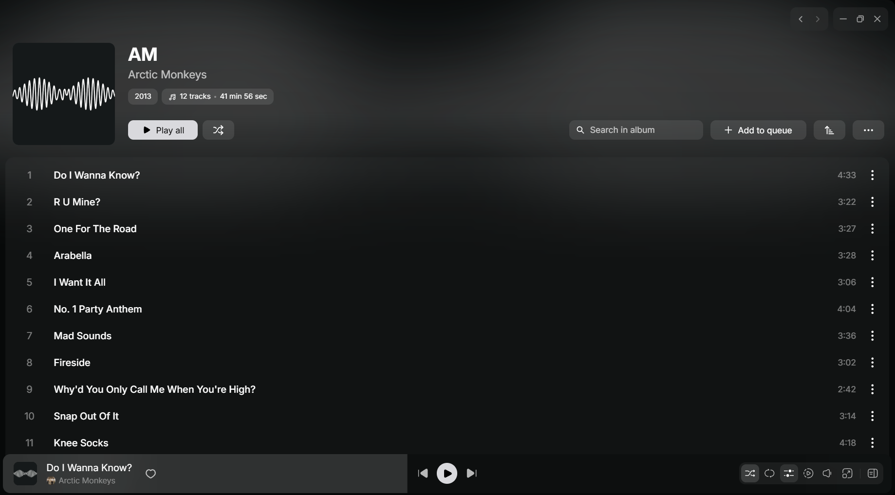
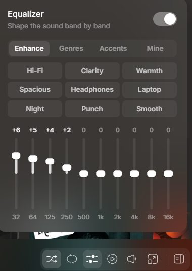
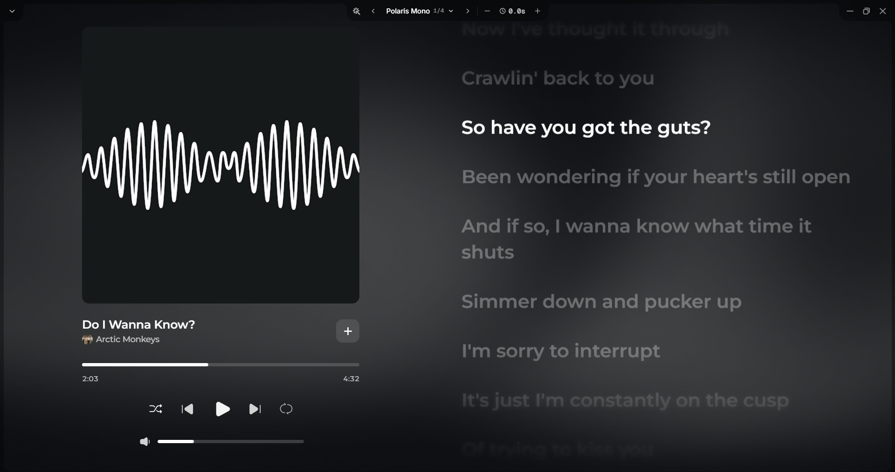

# Songies roadmap (agreed 2026-11-01)

Work through these in order. Each one goes through the usual flow: a short
design conversation, a design doc, a plan, then the build.

The screenshots are from **Liner** (github.com/tryliner/desktop), which the
user likes. **Liner's license is source-available and forbids copying its
code** into other projects: take the ideas and layouts only, and build them in
Songies' own code and style.

Released so far: **1.1.3** (equalizer, Favorites, queue fix, shelf arrows).

## 1. Star next to the title (quick) — done (on main, untagged)

In the desktop player bar the Favorites star sits at the right edge of the
song area; move it right after the title text (as Liner's heart does, see
the bottom-left of `roadmap/playlist-page.png`).

## 2. Island notifications — done (on main, untagged)

Replace the bottom snack bars (errors, "Added to queue", "Added to
playlist", …) with a small pill that pops up just above the player bar
(above the mini player on phones), like an island: it slides/grows in,
shows a short message (with an icon, and an action such as Undo or Retry
when there is one), and shrinks away. One at a time; a new one replaces the
old. All existing `PageSnackBars` calls move over to it.

## 3. Crash reporting — done (on main, untagged)

Goal: see crashes from the user's devices, per device and OS, to fix them.
Firebase Crashlytics only supports Android/iOS/macOS, so it would miss
Linux and Windows. **Decided: Sentry** (free Developer plan, 1 user, 5k
errors/month), which covers every Flutter platform. Opt-out
switch in Settings; no personal data in reports.

## 4. Report a bug

A **Report a bug** item (Settings and the help/⋯ menu): a short form (what
happened, optional screenshot, recent app log attached, app version, OS,
device) sent to a Discord channel through a webhook. A webhook URL shipped
inside the app can be extracted and abused, so the app should post to a
small Supabase Edge Function that forwards to Discord (with rate limiting);
until item 5 exists, a first version may post directly.

## 5. Accounts and cloud sync (Supabase, free tier)

Big; built in stages, each released on its own:

1. **Sign up / log in** with Supabase Auth (email + password, maybe Google).
   Optional: the app keeps working signed out. Note: the free tier pauses a
   project after 7 days with no activity.
2. **Cloud sync of the library** (playlists, Favorites, saved artists,
   settings worth syncing) through Postgres with row-level security, replacing
   today's LAN peer-to-peer sync (pairing codes, mDNS, `lib/sync/`). Decide
   in design: keep LAN sync as a fallback or remove it; how to move existing
   paired libraries into the account.
3. **Remote control** (Spotify Connect-like): see the user's other signed-in
   devices, and play/pause/skip/change songs on one device from another,
   through Supabase Realtime.
4. **Listen together**: a shared session others join by link/code; play,
   seek and queue stay in step across listeners.

## 6. Playlist page redesign, with search and sort

- Header: cover on the left; the name large with the owner/source under it;
  chips for the track count and total length; **Play all** and **Shuffle**.
- Toolbar on the right: **Search in playlist**, **Add to queue** (the whole
  playlist), a **sort** button, and the ⋯ menu.
- Track list: a clean numbered list (number, title, length, ⋯) on a raised
  panel.
- Sort: **Default (order added)**, **Title**, **Duration**.

## 7. Equalizer upgrade (panel, custom, speed)

- Opens as a panel from a player-bar button (as well as Settings).
- On/off switch; 10 band sliders, 32 Hz – 16 kHz, each showing its dB.
- Preset groups as tabs: **Enhance** (Hi-Fi, Clarity, Warmth, Spacious,
  Headphones, Laptop, Night, Punch, Smooth), **Genres**, **Accents**, and
  **Mine** (the user's own presets).
- **Playback speed** (just_audio supports it everywhere).
- **Windows:** Liner's equalizer works on Windows because Liner is Electron
  (Chromium's Web Audio). Songies plays through mpv, and Windows ships a
  minimal libmpv that may lack the `equalizer` filter, which is why Windows
  shows "Not available on Windows yet". Before building, run a 2-minute check
  on the user's Windows PC; if the filter is there, enable it in
  `equalizerFor` (lib/player/equalizer.dart).

## 8. Library card view

A list / cards switch in the library; playlists shown as cover cards.

## 9. Saved artist pages

Tapping an artist anywhere opens their YouTube Music page (that page already
exists); add a **Save** button and a **Saved artists** section in the
library, synced like playlists.

## 10. Full-screen player redesign

- Left: a big cover; title and artist under it with a **+** (add to playlist)
  button; seek bar with times; shuffle, previous, play, next, repeat; a
  volume slider.
- Right: large lyrics; the current line bright, the others fading out
  towards the top and bottom.
- Background: the cover, heavily blurred, behind everything (frosted glass).
- Top bar: a lyrics font picker (‹ font name 1/4 ›), a lyrics timing nudge
  (− 0.0 s +), and ⌄ to close.

## Parked (designs and plans written, not started)

- Crossfade: `superpowers/plans/2026-11-01-crossfade.md`
- Android Auto: `superpowers/plans/2026-11-01-android-auto.md`
- Spotify playlist import: `superpowers/plans/2026-11-01-spotify-import.md`

## Waiting on the user's checks

- Equalizer on Linux: a preset holds across songs, after the queue ends,
  and after a restart; whether switching mid-song clicks. Android: a preset
  survives a restart.
- Windows YouTube sign-in now registers (fix in 1.1.2).
- Favorites sync between two devices.
- The age-restricted song on Android while signed in.
